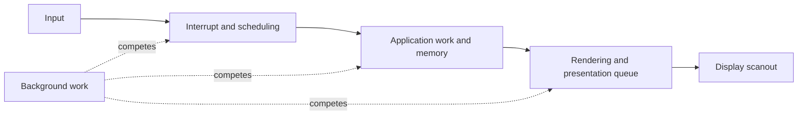

# Desktop priorities for Super Alpha

Optimize the time from an input to a useful visible result while ordinary
background work is running. Then optimize energy while waiting for the next input.
The proposed first desktop has two capable physical cores, a useful memory
hierarchy, enough RAM, reliable display and audio, and a small maintained software
stack. SMT remains excluded. More cores and sophisticated execution are subsequent
experiments.

Count simplicity across hardware, firmware, compilers, kernel code, drivers,
verification, and ongoing maintenance. Aim for a few explicit contracts and one
well-supported software profile. Keep exploratory configurations in experiments;
do not turn every research alternative into a permanent compatibility mode.

This is the product-level companion to the [research direction](architecture-direction.md).
The [next steps](next-steps.md) still govern implementation, with the decoder as
the sole active lesson. The budgets below are proposed goals, not measured results
or predictions for the current RTL. Source-dependent observations were checked on
2026-11-11; recheck them against pinned revisions before porting.

## What an excellent basic desktop should do

The representative workload is a terminal, editor, file manager, documents and
web browsing, with audio playing and occasional compilation or file transfers.
Contemporary web applications are an explicit software/performance investigation;
a minimal browser does not establish support for them. Gaming, workstation GPU
compute, virtual machines, and large AI models are outside this first target.

Measure delays and missed deadlines, including their distribution under load.
A good average can hide the pauses the owner notices. Keep independent foreground
and background progress measurements so starving background work cannot produce a
false success. Google's [RAIL model](https://web.dev/articles/rail) is useful for
separating response, animation, idle, and load; these are our own desktop budgets.

Timestamp each boundary. Speeding up one stage cannot remove time spent waiting
in another; the tests should identify which stage consumed the budget.

| Experience | Initial research budget | Measurement |
| --- | --- | --- |
| Typing, pointer actions, switching windows | Input-to-visible-result p99 at most 50 ms; p99.9 at most 100 ms | Record event and presentation timestamps, maxima, and bursts of slow events. Presentation is a proxy until physical input-to-photon measurements exist. |
| Scrolling and window movement | 1080p at 60 Hz; fewer than 0.1% missed presentation deadlines in the fixed local workload | A frame interval is 16.67 ms. Record gaps over 50 ms separately; average FPS is insufficient. |
| Audio during other work | No underruns in a 30-minute mixed-load run | Start at 48 kHz with 256-frame periods, giving 5.33 ms per period. Report actual buffering and output latency too. |
| Small native application launch | Warm launch at most 250 ms; cold launch at most 1 s | Use the same editor, document, rootfs, and launch-to-usable endpoint. Define process and page-cache state explicitly. |
| Memory and I/O pressure | Interaction remains within its budget and background work makes progress | Compile, copy files, and apply controlled memory pressure separately, then together. Record faults, reclaim stalls, and cancellation response. |
| Quiet idle and prompt wakeup | No unnecessary polling; wakeup fits the interaction budget | Record wakeups, idle residency, wake latency, and eventual whole-board power. Set watts and suspend/resume goals after the board and display are known. |

These are engineering targets for selected local workloads, not universal latency
guarantees. Keep browser/network delays separate from local rendering and input
latency. FPGA functional bring-up and projected ASIC performance need separate
reports.

## Where the effort should go

### Preserve foreground progress

One user still runs concurrent work: application logic, input handling, rendering,
audio, storage, networking, and background jobs. Two cores offer scheduling room
while one task is busy. A serialized application path still needs a capable core.
Chromium's [rendering architecture](https://developer.chrome.com/docs/chromium/renderingng-architecture)
illustrates both: it separates compositor and helper work while retaining a main
thread for substantial application work.

For illustration only, if 75% of an operation is serial, ideal parallel speedups
are 1.14x on two cores, 1.23x on four, and 1.28x on eight, using
`1 / (0.75 + 0.25 / cores)`. Real scheduling and memory overhead can reduce those
figures. Extra cores can improve responsiveness by handling competing jobs even
when they barely shorten that one operation.

Build two identical coherent cores first. Consider four only after a workload
shows useful parallelism and the memory system can serve it. Avoid an early
heterogeneous core design, its extra verification, and scheduler/power policies.

### Spend on locality and working memory

Useful scalar execution, cache hits, translations, and RAM capacity precede novel
instructions. Explore a modest L1 and shared L2 before increasing core count.
The 4 KiB blocking cache in the learning roadmap is an exercise size, not the
desktop cache specification.

Preserve physical-address capacity above 4 GiB in platform planning. Size RAM from
the selected applications' working sets and page-cache headroom; compare 4 GiB and
8 GiB budgets before choosing parts. These are experiments, not minimum software
requirements. Avoid relying on compression or swap to conceal an undersized normal
working set; evaluate their CPU and latency costs explicitly if used.

Use the existing compiler and libraries well. Compare `-O2`, size optimization,
and representative profile-guided builds before changing the ISA. Inspect emitted
code and helper calls. A smaller hot code footprint or a better memory-copy path
can help without adding architectural state. Keep holdout workloads to detect
overfitting to the training profile.

### Make display and data movement first-class platform work

For uncompressed 32-bit pixels, `1920 * 1080 * 4` is 8,294,400 bytes per frame.
The following is payload arithmetic for full-frame external-memory traffic,
excluding blanking, protocol overhead, caches, compression, and format conversion:

| Operation at 60 Hz | Payload traffic in decimal GB/s |
| --- | --- |
| Scanout reads one frame | 0.498 |
| One source read plus destination write, followed by scanout | 1.493 |
| Two image reads plus one blended output write, followed by scanout | 1.991 |

The experiment is to avoid redundant transfers: retain rendered content, redraw
damaged regions, share buffers with explicit ownership/fences, and use page flips.
Prefer a cursor plane so cursor drawing does not require repainting the desktop.
Linux already exposes planes, page-flip and damage mechanisms through
[DRM/KMS](https://docs.kernel.org/gpu/drm-kms.html).

Start with correct scanout, vblank, input, and a measured simple renderer. A
framebuffer is a functional milestone; it does not establish fast compositing,
video decoding, or WebGL. Select a graphics/media device and driver path before
promising those features. Reuse suitable existing controllers or target-specific
IP where practical; designing a complete GPU or DDR PHY is a separate major project.

Make DMA ownership, cache synchronization, ordering, and completion explicit.
Exercise display/audio traffic alongside CPU misses and bulk transfers. Bound bus
bursts and test arbitration for both deadline service and forward progress. A
second CPU cannot fix an interconnect that starves scanout.

For storage, optimize measured small-request and completion latency as well as
throughput. Include metadata, page faults, and durable saves in tests. Buffered
write acceptance must not be reported as completed durable storage. Keep storage
and network drivers asynchronous so slow devices do not occupy a CPU polling.

### Use modern OS mechanisms before inventing replacements

Keep the generic Linux scheduler initially. Implement accurate timers, interrupt
delivery, and the architecture hooks it needs. EEVDF explicitly considers latency
sensitive work, but that does not by itself solve long nonpreemptible kernel paths.
[Scheduler documentation](https://kernel.org/doc/html/latest/scheduler/sched-eevdf.html).

A concrete audit item: Linux v6.12's Alpha
[Kconfig](https://raw.githubusercontent.com/torvalds/linux/v6.12/arch/alpha/Kconfig)
selects `ARCH_NO_PREEMPT`. Recheck the chosen kernel. Do not simply delete the
selection: audit preemption counts, interrupt/exception return, context switching,
locking assumptions, and rescheduling. Prove correctness and measure maximum
IRQ-disabled and nonpreemptible intervals under mixed load.

Separate interactive and bulk jobs in a small resource policy. Investigate CPU
weights, memory protection/limits, and suitable I/O controls using
[cgroup v2](https://docs.kernel.org/admin-guide/cgroup-v2.html). Weights and
best-effort memory protection are not deadline guarantees. Avoid quotas that
periodically throttle the foreground path. Use
[pressure stall information](https://docs.kernel.org/accounting/psi.html) and
scheduler/I/O traces to find the real source of pauses.

Keep queues bounded. Coalesce obsolete redraws and pointer motion where semantics
allow it; do not accumulate seconds of stale visual work. Durable writes and other
non-discardable operations need backpressure and honest completion instead.
Make background work visible and cancellable. A small, well-maintained software
image is part of the performance design, including a workable update path.

### Be good at doing nothing

Provide a stable monotonic time source, one-shot timer events per core, and an
idle instruction/state that wakes reliably for interrupts. Keep timekeeping valid
when the core clock changes or stops. Linux's
[clocksource/clockevent model](https://docs.kernel.org/timers/timekeeping.html)
matches this separation.

Start with simple clock enables and idle entry; technology-specific clock gating
stays in adapters. Test the race between entering idle and an interrupt arriving.
Add [tickless idle](https://docs.kernel.org/timers/no_hz.html) and an appropriate
[CPU idle driver](https://docs.kernel.org/admin-guide/pm/cpuidle.html). Evaluate
deeper power states and voltage/frequency scaling only with a platform model and
wake-latency measurements. Faster completion can create more idle time, but total
energy and thermal behaviour must be measured rather than inferred from clock rate.

## A sensible architecture experiment

This is a reference configuration for a future timing/area experiment, not a
frozen RTL specification or an instruction to expand the active lesson.

| Component | First useful hypothesis | Comparison or gate |
| --- | --- | --- |
| Cores | Two identical short-pipeline, single-issue, in-order cores; no SMT | One versus two under mixed foreground/background work; four only after scaling is useful. |
| Integer execution | Good forwarding and early branch resolution; BWX, then CIX where cheap | Measure dependencies, instruction mix and helpers. CIX is useful coverage, not the main desktop performance strategy. |
| Floating point | Correct scalar IEEE operations and FP register/context state for the selected ABI | Complete the required common paths before claiming a general desktop. Check exceptional values and state across context switches. A functioning integer shell is an earlier milestone. |
| L1 caches | Try 32 KiB instruction and 32 KiB data per core, four ways, 64-byte lines | Compare smaller sizes and real array latency/area. Begin with physical indexing/tagging; optimize translation overlap only with alias and permission rules specified. |
| Shared cache | Try a 512 KiB L2, then compare no L2 and a larger option | Measure misses, interference, energy proxies, and achievable clock. Do not allocate SRAM solely to hit an arbitrary size. |
| Stores and coherence | Uncached, then write-through/invalidation for correctness | Evaluate writeback or committed-store buffering if bandwidth or stalls justify it. Define retirement, errors, barriers, and DMA visibility first; deferred writeback errors cannot silently use the earlier precise-store-fault contract. |
| Translation | Tagged TLBs, existing page layout initially, software refill baseline | Compare TLB sizing and a hardware walker using observed miss cost. Kernel preemption/idle integration gets attention before a speculative page-format redesign. |
| Platform | Existing-driver path for display, input, audio, storage and network; one-shot timer and IPIs | Verify software and DMA integration early. Vendor RAM/PHY/device logic stays outside the generic core. |
| Observability | Cycles, retired instructions, cache/TLB misses, stall categories, interrupts, idle and wake time | Define counter meanings and overlapping events. Start with simulation observation, then add OS-readable facilities without confusing them with Alpha's existing RPCC semantics. |

Keep scalar IEEE correctness ahead of a new vector ISA. Try standard MVI, library
optimization, or an existing graphics/media engine against real hot loops before
creating vector state, encodings, compiler support, and context-switch obligations.
Dedicated crypto or other accelerators likewise need a measured workload and a
software path.

## Treat speculation as a specific tradeoff

Retain the conservative execution baseline. However, judge it honestly: stalling
the front end until every predecessor is decoded and every branch resolved can
cost substantial throughput. A simple core still deserves a good front end,
early branch resolution, and efficient instruction delivery.

Measure branch frequency, resolution delays, and exposed fetch stalls. If those
dominate, compare a small predictor in a model before reaching for wide issue or
out-of-order execution. Distinguish predicted instruction fetch from speculative
data execution; neither is automatically free of observable effects. An in-order
label or absence of SMT is not a security proof. The existing
[speculation policy](architecture-direction.md) still applies.

Keep user/kernel permissions, executable-page control, correct FP context
ownership, and DMA containment in the platform contract. One human user still
runs components with different trust levels. Preserve ordinary fault isolation
and reliable recovery as part of simplicity.

Use verification to make that simplicity credible. Alongside independent
instruction models and seeded simulation, write portable SystemVerilog assertions
for small protocol blocks: request stability, no duplicate completion, reservation
invalidation, and cache-state invariants. Run appropriate assertions in simulation
and use suitable properties in formal tools. [SymbiYosys](https://yosyshq.readthedocs.io/projects/sby/en/latest/)
is an available approach to investigate, alongside commercial tools; it is not
a project requirement. Check each tool's supported language/property subset.
Record bounds, reset assumptions, and fairness constraints; a bounded check is
not a proof of the whole CPU. Introduce this with the relevant blocks, without
changing the active decoder exercise.

Choose implementation and signoff tools around the intended PDK, libraries, SRAM
macros, and qualified flow. Open tools are welcome for useful checks and
experiments. Separate RTL estimates, mapped synthesis, physical implementation,
and signoff results. Timing corners and constraints, parasitics, switching
activity, clock/reset crossings, and physical checks need explicit evidence
before making silicon claims. Tool-brand preference does not replace those gates.

## Software feasibility can dominate the schedule

The source audit gives a direction for experiments, not evidence that these
applications have been built or run here:

| Finding | Consequence and next proof |
| --- | --- |
| Alpha is absent from the checked official [Rust target tiers](https://doc.rust-lang.org/rustc/platform-support.html) and [LLVM target list](https://raw.githubusercontent.com/llvm/llvm-project/main/llvm/CMakeLists.txt). | GCC-based C/C++ reuse does not establish availability of the whole modern toolchain stack. Pin and build representative dependencies early. |
| [Rust's GCC backend has an Alpha work item](https://github.com/rust-lang/rustc_codegen_gcc/issues/742); the Rust project [reported progress](https://blog.rust-lang.org/2025/11/18/gsoc-2025-results/#bootstrap-of-rustc-with-rustc_codegen_gcc). Firefox [links Rust components](https://firefox-source-docs.mozilla.org/build/buildsystem/rust.html). | There is a concrete route to investigate. Prove the selected compiler, ABI, standard library and required crates before treating Firefox as a routine port. Progress on a backend is not a working browser. |
| WebKit's [build configuration](https://raw.githubusercontent.com/WebKit/WebKit/main/Source/cmake/WebKitFeatures.cmake) provides a C-loop interpreter configuration and rejects WebAssembly together with that mode. | Explore a pinned interpreter-based browser as a potentially smaller first experiment. Audit CPU detection, allocator/page-size assumptions, and atomics; execute JavaScriptCore, then the renderer and chosen pages. Alpha support, performance and application compatibility remain unproven. |
| Mesa's [LLVMpipe](https://docs.mesa3d.org/drivers/llvmpipe.html) uses runtime native code generation. | Do not assume a fast software OpenGL fallback is available on Alpha. Test the actual rendering backend or selected GPU driver; distinguish a displayed window from usable graphics. |

Use existing Alpha emulation for early ABI and application feasibility where it
matches the chosen ISA. Host-emulator wall time does not predict our CPU's speed.
Do not defer this audit until silicon, or silently redefine contemporary browsing
to mean static HTML when a candidate stack lacks needed functionality.

## Bounded research work for the next assistant

Keep the CPU lesson sequence unchanged. These investigations can accompany it
without writing the owner's functional RTL. Create the named output only when
undertaking its investigation; none of these results exist yet.

| Order | Investigation and output | Decision it must support |
| --- | --- | --- |
| 1 | `docs/desktop-software-audit.csv`: pinned compiler/rootfs, editor, compositor/rendering backend, browser engine, audio and storage path; build/run status and specific blockers | Which complete useful software stack can we support, and what maintenance work is unavoidable? |
| 2 | `tests/programs/desktop/`: after C support, small extracted workloads for parsing, allocation/pointer traversal, copying, image blending, floating point, and process/interrupt tests as available | Which CPU, memory and OS costs dominate? These kernels diagnose costs; full interactive workloads remain the acceptance tests. |
| 3 | Extend the timing model with measured/proposed memory latencies and competing DMA agents; sweep one cache or core parameter at a time | Where does area buy useful latency? Include refresh/contention and bounded progress; ideal RAM is not a desktop performance model. |
| 4 | Add preemption, timer, idle, and display/DMA items to `docs/linux-platform.md` and its executable prototype | Which kernel/platform changes make the desktop usable? Do they justify a native supervisor interface or a small compatibility layer? |
| 5 | Reproduce the experience table with a pinned image and deterministic input replay, then on target hardware | Does the machine remain usable during background work, and do optimizations preserve that result? |

For each run retain versions, binaries, configuration, memory/cache state, clocks,
input trace, sample counts, percentiles, maximum delays, deadline misses, and
background progress. Record emulated/modelled/measured results separately. Add
energy and thermal results only when evidence supports them. Repeated workloads
and a holdout set matter more than a large collection of unrelated microbenchmarks.

Use at least 10,000 identifiable interactions for initial tail-latency studies,
with fixed input rates and burst patterns; repeat runs and retain the distributions.
Do not estimate p99.9 from a handful of samples. Account for intentionally coalesced
pointer events separately; dropping keystrokes cannot improve the score.

A new supervisor interface remains a valid research proposal, but changing PAL
calls or page formats is not itself a desktop benefit. Prefer the option that
meets these workload goals with less combined hardware, verification, software,
and maintenance cost. The core should excel at ordinary scalar work; the platform
should move data efficiently; the OS should protect responsiveness and idle time.
