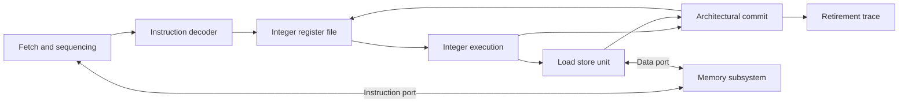

# Portable Alpha CPU implementation plan

Build a single core from independently testable blocks, run small Alpha programs
in simulation, and then run the same programs on an FPGA. The initial core uses
one instruction at a time so that instruction semantics, memory transactions, and
architectural state can be established before performance features are added.

The long-term destination is a multicore Alpha machine running Linux, with a
later Haiku port. Use one hardware thread per core; SMT is excluded. Keep the
default microarchitecture conservative and avoid speculative execution.
The first deliverable is a restricted integer bring-up subset; its instruction
support will be recorded explicitly as it grows.

Follow [Next steps for a modern Alpha core](next-steps.md) for the immediate work
order, concrete handoffs, and performance priorities. The stages below define
coverage and contracts; complete their required subsets incrementally.
The [research direction](architecture-direction.md) separates Alpha userspace
compatibility from a modern supervisor/platform design and maps the Linux changes.
The [desktop priorities](desktop-priorities.md) define the eventual user experience,
software feasibility checks, and experiments for latency, memory, graphics, and idle.

## Learning workflow

The project owner writes the functional RTL. The assistant supplies one exercise
at a time with a module interface, a compiling stub, behavioural tests, and a
short lesson. Tests describe the hardware contract and stay fixed while the
owner takes the block from fail to pass. Review and debugging start with hints;
complete RTL solutions require an explicit request.

The first exercise is the [integer register file](exercises/01-register-file.md).
The current lesson is the [instruction decoder](exercises/02-instruction-decoder.md).
Subsequent exercises follow the block dependencies below: basic integer execution,
branches, memory channels, a minimal executing core, and the load/store unit.
Broader arithmetic and byte operations follow that first working core.
The assistant can implement the simulator infrastructure and independent models
without completing the learner's blocks.

Run the initial exercises with Verilator inside WSL. Vivado belongs to the later
FPGA target and is not an alternative simulator for these lessons.

## Initial design choices

| Area | Initial choice |
| --- | --- |
| RTL | Synthesizable SystemVerilog for portable functional logic |
| Simulation | Verilator inside WSL, SystemVerilog unit testbenches, and a Python runner; add a C++ core harness when needed |
| Independent reference | A Python instruction model written from the published architecture |
| Execution | Single core, in order, multicycle, one instruction in flight |
| Eventual parallelism | SMP using physical cores, one hardware thread per core; no SMT |
| Speculation policy | No speculative execution by default; research additions need measured benefit and analysis of observable effects |
| Integer state | 32 architectural 64-bit integer registers, including R31, and a 64-bit PC |
| Instruction format | Alpha 32-bit instructions |
| Byte order | Little endian |
| Initial software | Statically linked freestanding integer C and assembly using nontrapping arithmetic forms |
| Compiler starting point | EV56 with BWX enabled once verified; floating-point register use disabled |
| Addressing | A defined physical address map; address translation follows later |
| Memory | Separate instruction and data request/response ports with ideal backing storage |
| Timing | One clock domain; synchronous reset at the portable core boundary |
| Initial memory ordering | Complete each instruction's memory transaction before advancing |

BWX provides byte and word access. Floating-point execution, privileged execution,
supervisor services, translation, cache coherence, and the other extensions have
their own later milestones. The initial subset is sufficient only for programs built to
its recorded restrictions. In particular, disabling floating-point register use
creates a restricted software environment; it does not establish full EV56 or
standard Alpha ABI compatibility.

Verilator 5.046 was reported by the host's WSL installation. Stage 0 establishes
the host build and test toolchain. The Alpha cross compiler is needed when the
compiled-program exercises are reached.

## Boundaries between the core and its implementation

Keep instruction semantics, sequencing, register state, execution units, and
load/store control portable. Keep board connections and technology-specific
storage behind adapters.

| Portable logic | Simulation model or target adapter |
| --- | --- |
| Instruction fetch and memory ports | Ideal RAM, ROM, or a platform memory controller |
| Load/store unit | Address map, MMIO devices, and external bus adaptation |
| Future cache controller and miss handling | Ideal tag/data arrays, inferred FPGA RAM, or ASIC SRAM macros |
| Integer register file behaviour | Generic RTL initially; a later implementation must preserve its port contract |
| Clocked CPU state | Board clocks, PLLs, and reset synchronization |
| Future interrupt interface | Timer, interrupt controller, and board wiring |

A cache controller remains real functional logic even when its tag and data arrays
are ideal. Its hit/miss decisions, write policies, refill handling, and faults
must still be implemented and tested.

Simulation models may use host facilities for storage, image loading, and logs.
The generic core must execute instructions itself. Place simulation-only delays,
file access, and host callbacks outside the synthesizable core.



Architectural commit is initially a state in the core controller. Extract a
separate module when its behaviour warrants it.

## Contracts to define before integration

### Register file

Start with two combinational read ports and one write port that updates on the
rising clock edge. Reads observe the stored value; after an enabled write edge,
they observe the new value. Reads of R31 return zero and writes to R31 leave it
unchanged. Instruction-specific effects and exceptions still belong to execution
logic, including when a destination is R31.

Reset establishes control state and the reset PC. Startup code establishes the
register values it uses. Do not make software depend on all registers or backing
RAM being cleared by reset. Test the register file with explicitly initialized
values and initialize simulation memory from a reproducible seed or image.

A synchronous SRAM macro cannot replace this register file by changing its read
latency silently. It needs an adapter that preserves the contract or a deliberate
operand-read interface change with corresponding core tests.

### Instruction and data ports

Use ready/valid request and response channels. Define the shared record types
before writing the memory model and load/store unit.

| Channel | Payload |
| --- | --- |
| Instruction request | 64-bit byte address, aligned to four bytes |
| Instruction response | 32-bit instruction and success/error status |
| Data request | Read/write operation, aligned eight-byte bus address, 64-bit write data, and eight byte enables |
| Data response | 64-bit read data and success/error status, including an acknowledgement for writes |

The load/store unit retains the original effective address, access size, and lane
position. Byte enables apply to reads and writes so that a peripheral can observe
the requested access width. Preserve MMIO access semantics through adapters;
widening an access or implementing a store as a read/modify/write can change device
behaviour.

For the MVP, allow one outstanding transaction across both ports. A request is
accepted on a rising edge with both request valid and ready asserted. Keep the
request payload stable while it is stalled. Return exactly one response for each
accepted request. Keep a response and its payload stable until accepted.

The default ideal model responds no earlier than one clock after accepting a
request. It must also support bounded variable delays, request backpressure, and
injected access errors. The core must make progress when the model eventually
accepts requests and supplies responses.

For the initial model, successful writes take effect exactly once at response
acceptance. A write error has no memory or MMIO effect. Treat that as a required
adapter contract; a future external bus with partial-write errors needs an
explicit fault policy. Core and memory-adapter reset are coordinated during
bring-up: discard pending transactions and responses together. Reset clears
transaction state while retaining backing storage contents. Independent reset
and recovery during live external transactions require a later design.

### Fault and retirement outputs

Expose an observational retirement event for every successfully completed
instruction. Include an instruction sequence number, PC, instruction bits, next
PC, register write, and logical memory access information. Record access width,
address, byte enables, and data so that a later cache writeback cannot be mistaken
for an architectural store. Emit the event at the same architectural boundary
that updates register and PC state. Logging must not control instruction results.

Expose a separate fault event containing the instruction PC, instruction bits
when available, cause, and faulting address when applicable. Initial stop causes
are invalid/unsupported instructions, alignment failures, and access errors.
For these causes, stop for inspection without an architectural write or a
successful retirement event for the failing instruction. Older completed
instructions retain their effects.

Keep arithmetic-trapping forms outside this initial profile. Alpha arithmetic
traps can accompany a completed operation and a written result. Specify and test
their completion and exception semantics before enabling them, including the
corresponding trace representation. See the handbook's
[quadword add definition](../references/alpha/manuals/alpha-architecture-handbook-1996.pdf#page=86).

This initial fault sink is a development interface. Implement the selected
exception/supervisor contract before OS integration. Historical PAL compatibility
is a separate choice, not a requirement for the new core.
Distinguish invalid encodings from valid instructions outside the implemented
subset. Program success comes from a test completion device or an expected
execution trace; an unsupported instruction is not a successful program exit.

## Implementation stages

Complete the relevant block's pass condition before depending on it in a larger
block. Add one instruction family or functional block per reviewable change.
Use the next-steps queue to integrate the first six non-memory instructions, then
LDQ/STQ, before completing the broader stage 2 and 3 instruction families. A
partial slice passing does not mark the whole stage complete.

### Stage 0 Define the subset and test harness

Create the source layout, a repeatable Verilator build, clock/reset driving,
bounded test execution, and a common failure report. Record simulator, host
compiler, and test runner versions. Record cross compiler versions when that
toolchain is introduced.

Create an instruction inventory with mnemonic, encoding/function, source manual
section, implementation stage, supported restrictions, reference-model status,
and test status. Separate the bring-up subset from a complete Alpha target.
Define the reset vector, simulation ROM/RAM/MMIO map, and memory-channel records.

Start the independent model with integer state, PC state, fixed-width arithmetic,
and the first few instruction semantics. The model produces expected state and
retirement events. Keep its decode and semantic implementation separate from RTL.

Pass condition: a clean checkout can build and run a small clocked block test,
an intentional mismatch returns failure, and a timeout produces a bounded error.
The inventory and interface definitions exist before core integration starts.

### Stage 1 Register file and decoder

Implement `alpha_regfile` and `alpha_decode` as separate blocks. Decode instruction
formats into register selections, literal/immediate values, operation class,
suboperation, and legality/support status. Default every output on every path.

Test every register address, both read ports, disabled and consecutive writes,
same-register read/write timing, and R31. Test positive and negative immediate
boundaries, register and literal forms, function fields, and invalid/unsupported
encodings. Keep hand-checked instruction encodings alongside assembler-generated
cases so that the decoder and its test generator do not share a single mistake.

Pass condition: the register file passes a seeded transaction scoreboard and each
enabled decoder entry has directed encoding tests. Invalid input cannot reuse
control signals from a previously decoded instruction.

### Stage 2 Integer execution blocks

Build and test these functional units independently:

| Block | Behaviour and important cases |
| --- | --- |
| `alpha_alu` | Address arithmetic, longword/quadword add and subtract, Boolean operations, shifts, comparisons, and conditional moves |
| `alpha_branch` | PC increment, relative targets, taken/untaken conditions, indirect target handling, and return-address values |
| `alpha_byteops` | Extract, insert, mask, ZAP/ZAPNOT, byte comparisons, and BWX sign extension |

Introduce operation families gradually. Test zero, all ones, sign boundaries,
carry/wrap boundaries, shift counts around operand-width boundaries, every byte
position, and source/destination register overlap. Check Alpha's canonical
sign-extended 32-bit results explicitly. Start with nontrapping arithmetic forms.
Trapping overflow forms require their specified result and trap behaviour, with
separate tests from the initial fault sink.

Use independently calculated mathematical results and documented instruction
rules as the oracle. Avoid deriving expected output with a copy of the RTL's
case statement or bit-slicing expressions.

Pass condition: directed and seeded random operand tests pass for every operation
currently enabled. Branch tests verify both target and link value. The instruction
inventory identifies remaining arithmetic forms explicitly.

### Stage 3 Memory model and load store unit

First test the memory-channel model with a small request driver. Then test
`alpha_lsu` against it without a CPU attached. Implement effective-address
handling using the execution unit's computed address, alignment checks, lane
selection, byte enables, data placement, and result extension.

Cover ordinary longword and quadword loads/stores, BWX byte/word loads/stores,
and the Alpha `LDQ_U`/`STQ_U` alignment rules. Follow the instruction definitions;
these instructions do not mean an unrestricted host-style unaligned access.

Test all relevant byte offsets, sign boundaries, neighbouring-byte preservation,
ordinary alignment faults, read/write errors, delayed responses, request stalls,
and reset with a pending transaction. Test that stores and MMIO writes occur
exactly once. Include invalid/unmapped addresses instead of silently truncating
all accesses into the configured RAM.

Pass condition: the LSU matches a byte-addressed software memory scoreboard and
has no dependence on a particular response latency. Fault cases preserve the
required register and memory state.

### Stage 4 Assemble the smallest executing core

Connect fetch, decode, operand read, execution, commit, and PC update using a
simple controller. A useful first sequence is fetch request, fetch response,
decode/read, execute, optional data request/response, and commit. Share execution
hardware where it keeps the controller understandable.

Start with a small program using address/immediate construction, register
arithmetic, and a branch. Add memory instructions after the non-memory path passes.
Emit the retirement and fault events from the outset.

Pass condition: short directed programs match the independent model at every
retirement, including PC and memory effects. Repeat them with fixed and varying
memory delays. Include dependency chains, loops, calls/returns once supported,
and faults following successful instructions.

### Stage 5 Complete the integer subset for freestanding programs

Expand the inventory to cover the selected compiler target's integer instructions:
address formation, scaled arithmetic, comparisons, conditional moves, bit/byte
operations, branches, calls/returns, memory accesses, and BWX. Implement
`alpha_multiplier` separately with a request/completion interface for longword,
quadword, and high-product forms. Test its latency and backpressure independently.

Alpha integer division uses software routines. Include the runtime helpers
actually needed by test programs; do not add an invented divide opcode. Implement
feature reporting only for completed extensions. Classify barriers and memory
hints against the specification: the initial serialized design can satisfy some
ordering requirements without additional hardware, but each enabled instruction
still needs its documented semantics.

The handbook's [integer arithmetic overview](../references/alpha/manuals/alpha-architecture-handbook-1996.pdf#page=83)
describes division through high-product operations or software routines.

Pass condition: all selected integer forms have block/instruction tests and model
support. Longer seeded programs match at retirement, including operand overlap
and faults. Instruction coverage reports both what ran and what remains unsupported.

### Stage 6 Run GCC programs in simulation

Add startup assembly, a linker script, and an ELF loader that loads program
segments, checks address ranges, and initializes their zero-fill regions.
Establish the stack, procedure/global-pointer conventions, initialized data,
and BSS. Keep program loading and reset sequencing reproducible.

After BWX is verified, start compiler experiments with
`-mcpu=ev56 -mbwx -mno-fp-regs -mno-cix -mno-fix -mno-max`.
Apply consistent flags to all startup and runtime objects. Audit disassembly and
unresolved helper symbols for each test
program. `-mno-fp-regs` implies software floating point and changes floating-point
argument conventions; use integer-only programs at this stage. `-msoft-float`
alone does not ensure supplied runtime libraries avoid hardware floating point.
[GCC Alpha options](https://gcc.gnu.org/onlinedocs/gcc/DEC-Alpha-Options.html).

Use small programs with observable results: array sums, byte copies, signed and
unsigned comparisons, shifts, nested function calls, multiplication, and variable
integer division through the selected helper routines. Exercise several
optimization levels. Supply only the memory/runtime functions those programs
need, with their own semantic tests.

Pass condition: the ELF loader and startup path run the same binaries reproducibly
with normal and delayed memory. Programs report expected signatures or exit codes,
and their retired execution agrees with the instruction model. There is no host
shortcut that executes an unimplemented instruction on the CPU's behalf.

### Stage 7 Add a small platform and FPGA adapter

Create a simulation SoC containing ROM/RAM, a completion device, a UART, and an
LED/output register. Specify register widths, reset values, and device side
effects. Test each peripheral independently, then test address decoding and MMIO
before running the core against them.

For the FPGA, add a board wrapper for clock/reset, pin constraints, inferred or
vendor RAM, and any programming/loading mechanism. The wrapper adapts the existing
ports to these resources. Keep vendor primitives and pin names outside the core.
Choose the board and its memory budget when this stage is reached.

Pass condition: simulation checks exact UART output and output-register changes.
The FPGA runs assembly that blinks an LED and drives UART, then runs one of the
same GCC-produced programs already checked in simulation. Record the bitstream,
program image, target clocks, and observed output. Simulate the changed storage
latencies before programming the board.

Stages 0 through 6 establish the single-core simulation goal. Stage 7 establishes
the FPGA LED/UART goal and carries the compiled C result onto hardware.

## Later milestones for the generic CPU

Each addition keeps the retirement tests and gains its own smaller block tests.
These are separate capabilities; an uncached multicycle core remains useful while
they are developed.

| Capability | Work and completion criterion |
| --- | --- |
| Caches | Build one small blocking cache first, using ideal synchronous tag/data arrays. Test hits, misses, refill, byte writes, eviction, reset, faults, and MMIO bypass against an uncached memory oracle. Choose and document write policy and line size before coding. Apply the design to instruction/data paths incrementally. |
| SRAM adapters | Specify array ports, latency, byte masks, read-during-write behaviour, and initialization. Run the same storage tests against ideal, FPGA, and eventual ASIC implementations. Reset valid/control state rather than requiring large data arrays to clear. |
| Privileged architecture | Compare a small native supervisor interface with a narrow PAL compatibility layer using the research direction, then prototype the chosen Linux integration. Define state, trap/return semantics, and privileged encodings before RTL. Preserve specified arithmetic result/trap behaviour. |
| Address translation | Test TLB lookup and permissions independently, then refill, invalidation, and fault delivery through the chosen supervisor interface. Initially retain Linux/Alpha page tables; compare software refill with a hardware walker after establishing a baseline. |
| Floating point | Add floating-point registers and individual operations with an independent numerical oracle. Test rounding, conversions, exceptional values, and Alpha exception behaviour before enabling an ABI or extension that requires them. |
| Atomics and ordering | Implement load-locked/store-conditional and barriers with explicit reservation state. Test success, forced failure, conflicting writes, and ordering. Extend these tests to shared memory before adding a second core. |
| Pipeline | Introduce a short single-issue pipeline with stalls and forwarding. Interlock unresolved control flow and older faults; gate memory accesses on permissions. Preserve the retirement trace and test forbidden requests at cache/memory interfaces. |
| Speculation | Deferred from the default design. Research prediction or speculative loads only with performance evidence and analysis of observable microarchitectural effects; retirement correctness alone is insufficient. |
| Linux on one core | Pin kernel/toolchain/rootfs, preserve the selected Alpha userspace ABI, and document native supervisor/boot departures with specific kernel patches. Cover MMU, interrupts, atomics, and required floating-point support. Pass initramfs shell, process switching, faults, and isolation tests. |
| SMP | Begin with two physical cores and private data caches disabled. Verify shared-memory ordering and reservations, then coherent private caches, secondary startup, IPIs, and TLB shootdowns. Boot SMP Linux and test shared mappings and scheduling before adding cores. No SMT. |
| Haiku | Port after the Linux platform contracts are established. Track kernel, compiler/runtime, and driver work alongside hardware. |
| Desktop experience | Prove the selected application/toolchain and rendering path, then test foreground latency, frame/audio deadlines, memory/I/O contention, and idle/wakeup using the desktop priorities. Linux boot alone does not establish desktop readiness. |

## Verification policy

Use block tests for local behaviour, instruction tests for architectural semantics,
and program tests for interactions and software conventions. Compare architectural
results rather than cycle counts so that memory adapters and future pipeline
changes can reuse the same expected results.

- Every implemented instruction has directed tests, a source reference, an
  independent expected result, and an inventory entry. Exercise exception forms
  and zero-register cases where the instruction definition makes them meaningful.
- Add seeded random tests where input combinations are large. Generate legal
  programs within the supported subset and keep failure seeds reproducible.
- Assert request stability, one response per accepted request, completion only
  for a pending transaction, single register write per MVP retirement, and
  absence of architectural writes for the initial bring-up fault causes.
- Run integrations with immediate availability of ready signals and with request
  stalls, variable response delays, and injected errors. Test reset at transaction
  boundaries and while requests are pending under the coordinated reset contract.
- Give every test a cycle or instruction bound. On failure, retain the program
  image, tool versions, seed, PC/instruction, expected and actual events, and a
  waveform or short trace around the mismatch.
- Once the basic model works, use a pinned external Alpha emulator as an
  additional black-box check where its execution environment matches. Keep the
  project's own model independently specified. Compare defined architectural
  behaviour and exclude implementation-dependent or unpredictable outcomes.
- Treat warnings about widths, signedness, unintended latches, and unused control
  paths as issues to resolve. Keep narrow, justified simulator waivers local.
- Check the actual simulator's initialization semantics. An initially zero-valued
  simulation object is insufficient evidence that hardware or startup software
  initializes it correctly.

Enable assertions in the recorded simulator configuration and provide waveforms
on request. Verilator's build, lint, assertion, and trace options are documented
in its [command reference](https://verilator.org/guide/latest/exe_verilator.html).

## Proposed source layout

```text
AGENTS.md
docs/
  implementation-plan.md
  exercises/                 # One lesson per block or instruction family
  next-steps.md               # Immediate execution order and modern priorities
  architecture-direction.md  # Research tradeoffs and Linux patch map
  desktop-priorities.md       # Experience budgets and platform experiments
  isa-support.csv             # Current decoder subset; expand with execution
  interfaces.md              # Add in stage 0
rtl/
  core/                      # Portable CPU and functional units
  memory/                    # Future portable cache controllers and storage interfaces
models/
  memory/                    # Ideal storage models
  peripherals/               # Simulation device models
sim/
  __main__.py                # Exercise runner entry point
  runner.py                  # Verilator build and result handling
  cpp/                       # Later core harness and trace capture when needed
  reference/                 # Independent instruction model
tests/
  unit/
  isa/
  programs/
sw/
  startup/
  runtime/
  linker/
targets/
  fpga/<board>/
  asic/<technology>/
references/alpha/            # Existing manuals and papers
build/                       # Generated output; exclude from version control
```

Create directories when their first implementation arrives. The initial Python
entry point lists exercises and runs a selected block or named test. Add lint,
ISA/program tests, and the full regression as those components arrive. Add board
build targets separately.

## Current implementation slice

Preserve the completed register file and finish the active decoder exercise.
Then follow [the next-steps queue](next-steps.md): small ALU and branch blocks,
tested memory infrastructure, a six-instruction core, and standalone LDQ/STQ
support before expanding toward freestanding C. Prepare one lesson at a time;
the owner continues to implement the functional RTL.

Keep the initial source of architectural behaviour in the published manuals listed
in the [reference index](../references/alpha/INDEX.txt). The 21264 and MVI papers
provide implementation background, while Tarantula remains optional research.
